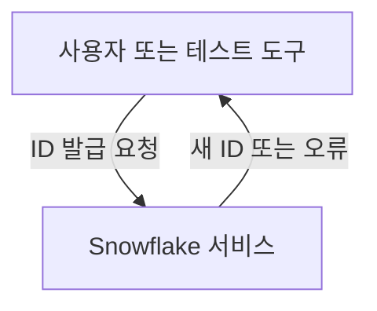
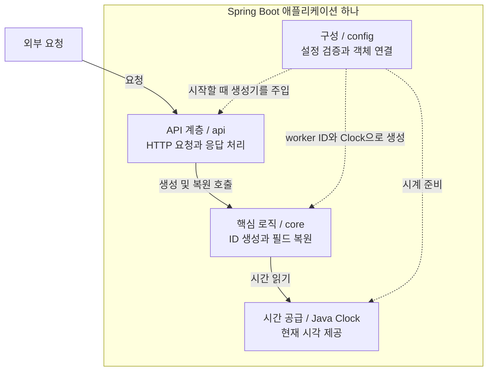
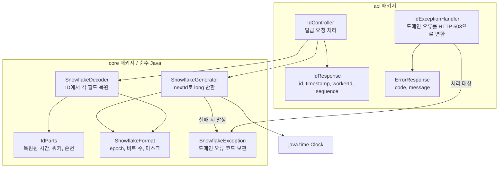
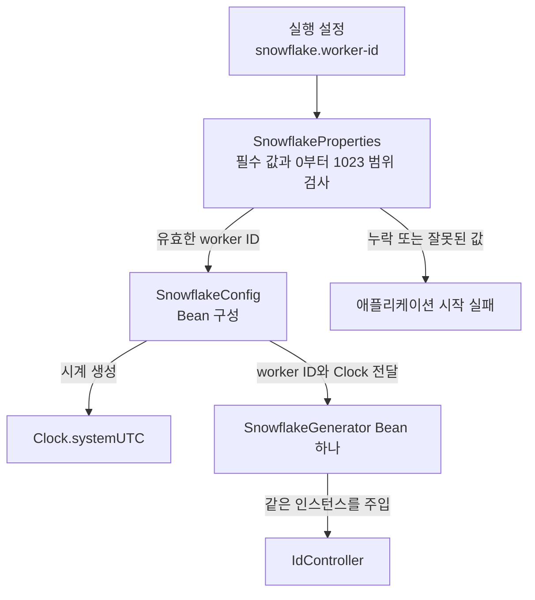
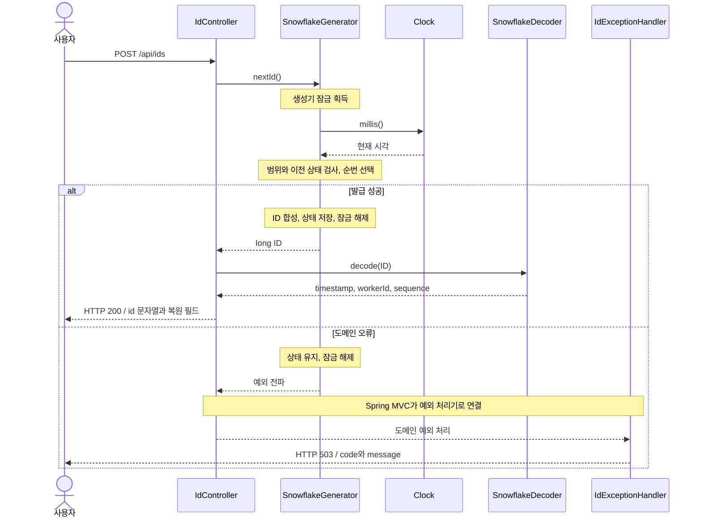
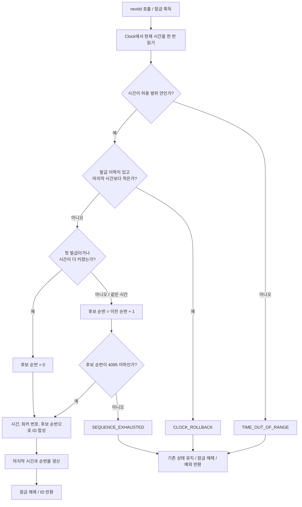

# Snowflake 예상 아키텍처

[설계 v0.1](design.md)대로 구현했을 때의 예상 구조다. 현재 구현된 코드의 구조가 아니다.
Java + Spring Boot는 사용자 확정이며, 나머지 정책과 아래 세부 클래스명은 제안이다.

위에서 아래로 **서비스 전체 → 책임별 계층 → 클래스 → 요청 흐름 → 내부 알고리즘** 순서로 읽는다.
여기서 단계는 같은 시스템을 확대해 보는 수준이다. 단계를 하나 내려갈 때마다
새로운 서버나 계층을 추가한다는 뜻은 아니다.

Mermaid 미리보기를 지원하는 뷰어에서 다이어그램으로 표시된다.
코드만 보이면 해당 뷰어의 Mermaid 지원을 확인한다. 텍스트 도식은 [설계서](design.md)에 있다.

## 1. 가장 멀리서 보기: 무엇을 하는 시스템인가?

사용자가 번호를 요청하면 서버가 ID 하나를 만들어 돌려준다.
생성할 수 없는 상황이면 번호 대신 오류를 알려 준다.



이 토이의 목적은 ID 생성 원리를 실습하는 것이다. DB 저장이나 주문 처리는 포함하지 않는다.

## 2. 서버 안으로 보기: 어느 계층이 무엇을 맡는가?

**API 계층은 통역**, **Core는 번호를 만드는 로봇**, **Config는 로봇을 준비하는 조립 담당**이다.
Config는 요청이 지나가는 다음 단계가 아니라 서버 시작 시 필요한 객체를 연결하는 곳이다.



실선은 요청 처리 중의 호출, 점선은 시작 시 객체 구성 관계다.
Core는 Spring이나 HTTP를 몰라도 동작한다. 별도 Service·Repository 계층을 의무적으로 추가하지 않는다.
Core의 생성기가 이번 실습의 기능을 직접 담당한다.

## 3. 더 가까이 보기: 어떤 클래스들이 필요한가?

각 상자는 예상 클래스 또는 데이터 타입이다. 화살표는 **사용하는 쪽 → 사용되는 쪽**이다.



Generator는 ID를 만들고, Controller는 그 ID를 Decoder에 전달해 응답 필드를 얻는다.
응답 시간을 만들려고 시계를 다시 읽지 않는다. Decoder가 Generator를 호출하지도 않는다.
`SnowflakeFormat`은 생성·복원이 같은 비트 규칙을 사용하기 위한 상수 모음이라는 제안이다.
`IdParts` 등의 정확한 파일 분리는 구현 시 조정할 수 있지만 책임은 유지한다.

서버 시작 시에는 다음과 같이 객체를 준비한다.



생성기 Bean 하나는 **애플리케이션 프로세스마다 하나**라는 뜻이다.
서버 두 개를 실행하면 생성기도 각각 하나씩 있고, 서로 다른 워커 번호를 설정해야 한다.

## 4. 실제 요청을 따라가기: 어떤 순서로 호출되는가?

번호를 만들었다면 200 응답을, 정해 둔 생성 오류가 났다면 503 응답을 돌려준다.



오류 경로의 Controller → 예외 처리기 화살표는 예외 전달을 나타낸다.
Controller가 직접 예외 처리기 메서드를 호출하는 코드를 작성한다는 뜻은 아니다.
성공 응답의 `id`만 문자열로 바꾸며 생성기 내부 계산에는 `long`을 쓴다.

## 5. 가장 안쪽 보기: 생성기는 어떻게 판단하는가?

아래 전체 과정은 같은 생성기에서 한 번에 한 요청만 수행한다.
기억하는 값은 **마지막 성공 시각(lastTimestamp)**과 **그때의 순번(sequence)**이다.



후보 순번은 성공하기 전까지 저장하지 않는다. 그래서 오류가 나도 이전 기록이 유지된다.
대기하거나 내부에서 재시도하는 경로는 없다. 이는 승인 전인 즉시 오류 정책 제안에 해당한다.

## 6. 이 구조가 파일로 만들어지면

아래는 구현 경로 예시다. 아직 이 Java 파일들이 존재한다는 뜻은 아니다.

```text
src/main/java/com/example/snowflake/
├── SnowflakeApplication.java
├── api/
│   ├── IdController.java
│   ├── IdResponse.java
│   ├── IdExceptionHandler.java
│   └── ErrorResponse.java
├── core/
│   ├── SnowflakeGenerator.java
│   ├── SnowflakeDecoder.java
│   ├── SnowflakeFormat.java
│   ├── IdParts.java
│   └── SnowflakeException.java
└── config/
    ├── SnowflakeConfig.java
    └── SnowflakeProperties.java

src/main/resources/
└── application.yml

src/test/java/com/example/snowflake/
├── core/       생성·복원·경계·동시성 테스트
├── api/        HTTP 성공·오류 응답 테스트
├── config/     설정 누락·범위 오류 테스트
└── support/    시간을 제어하는 테스트용 Clock
```

`application.yml`에 워커 기본값을 넣지 않는다. 실행할 때 필수 값으로 제공한다.
Core 테스트는 Spring 서버 없이 실행하고, API·설정 테스트는 필요한 Spring 기능을 포함한다.
메인 에이전트의 자체 검증 후 새 컨텍스트 리뷰어가 이 구조와 [설계의 검증 계약](design.md)을 기준으로
코드·테스트·실행 증거를 독립 검토한다.
