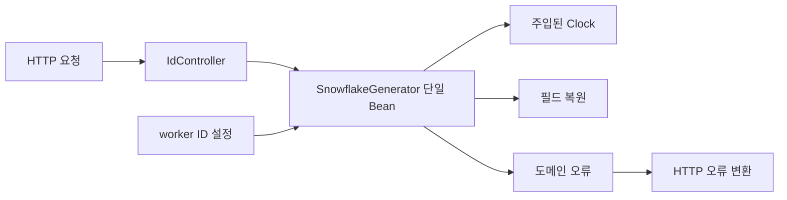

# Snowflake 실습 설계 v0.1 — 검토용 제안

상태: Java + Spring Boot만 사용자 확정. 나머지는 아래 추천안이며 구현 착수 전 확인한다.
사용자 목적: 원리를 이해하고 작은 ID 생성기를 구현한 뒤 Codex가 리뷰·검증한다.
목표 시간은 기존 안내의 2~3시간을 가정한다. 학습 질문·환경 설정 시간에 따라 조정한다.

## 범위와 기술 선택

- Java 21, Spring Boot 4.1.2, Gradle Wrapper 8.14.x 제안.
  Wrapper의 정확한 패치 버전은 Agy가 사용 가능한 공식 배포본으로 고정하고 기록한다.
  Java 21은 로컬 설치 확인. 기본 Java는 25이므로 실행·검증 JVM 21을 명시한다.
- 포함: 단일 ID 발급 HTTP API, 순수 Java 생성기, 필드 복원, 제어 가능한 시간,
  경계·동시성·웹 통합 테스트, 두 프로세스 실행 안내.
- 제외: DB, Redis, ZooKeeper, 인증, UI, Docker, 성능 목표 검증, 운영 배포,
  자동 워커 할당, 재시작에 걸친 고유성 보장. 로컬 실습 서버로 한정한다.

## 구조



루트 패키지 제안: `com.example.snowflake`.
`core`에는 Spring 의존성이 없는 생성기·복원·오류를, `config`에는 Bean과 설정 검증을,
`api`에는 컨트롤러·DTO·예외 처리를 둔다. 별도 저장소·서비스 계층은 필요 없다.
운영용 Clock은 `Clock.systemUTC()`, 테스트는 고정/변경 가능한 thread-safe Clock이다.
생성기 인스턴스마다 lastTimestamp와 sequence를 가지며 요청마다 새 생성기를 만들지 않는다.

## 비트와 용량

```text
[ 부호 1 = 0 ][ epoch 이후 ms 41 ][ worker 10 ][ sequence 12 ]
```

- epoch: `2026-01-01T00:00:00Z`, 코드 상수로 고정.
- 시간: 0 ~ 2^41-1 ms, 약 69.7년. epoch 이전·최댓값 초과는 오류.
- 워커: 0~1023, 순번: 0~4095. 워커 하나당 같은 ms에 최대 4096개.
  이것은 비트 용량이며 측정된 처리량이나 성능 보장이 아니다.
- ID는 음수가 아닌 Java long. epoch 순간 워커 0·순번 0의 ID 0도 유효하다.
- 합성: `(elapsed << 22) | ((long) workerId << 12) | sequence`.
- 복원: `elapsed=id >>> 22`, `worker=(id >>> 12) & 1023`, `sequence=id & 4095`.
  시간 복원은 epoch + elapsed. 음수 입력은 거부한다.

## 생성 계약과 상태 전이

`SnowflakeGenerator(int workerId, Clock clock)` / `long nextId()` 제안.
workerId 범위 밖과 null Clock은 생성 시 거부한다.
`nextId()` 전체를 synchronized로 보호하고 잠금 안에서 시간을 한 번 읽는다.
lastTimestamp의 초기 상태는 미발급을 나타내는 별도 sentinel로 표현한다.

1. 현재 시간이 epoch~최댓값 범위인지 먼저 검사한다. 실패 시 TIME_OUT_OF_RANGE.
   차이 계산 전에 절대 시각 범위를 비교해 long 뺄셈 overflow도 피한다.
2. 발급 이력이 있고 현재 시간이 lastTimestamp보다 작으면 CLOCK_ROLLBACK.
3. 첫 발급 또는 더 큰 ms이면 후보 sequence=0.
4. 같은 ms이면 후보 sequence=이전+1. 4095를 넘으면 SEQUENCE_EXHAUSTED.
5. 성공할 때만 lastTimestamp·sequence를 저장하고 ID를 반환한다.
   모든 실패는 이전 상태를 그대로 보존한다. 대기·내부 재시도는 하지 않는다.

역행 후 동일한 마지막 ms로 돌아오면 순번을 이어간다. 이미 소진됐다면 계속 소진 오류다.
마지막 ms보다 커지면 0부터 발급한다. 검증 순서는 시간 범위 → 역행 → 소진이다.

## 정책 선택 비교

| 상황 | 추천 | 대안과 비용 |
|---|---|---|
| 순번 소진 | 즉시 오류 | 다음 ms 대기는 중단/시간 멈춤/timeout 정책이 추가됨 |
| 시계 역행 | 즉시 오류 | 회복 대기는 지연, 논리 시간은 실제 시간과 차이 관리가 필요 |
| 워커 할당 | 실행 설정의 필수 값 | 자동 할당은 외부 조정·임대·충돌 관리가 필요 |

`snowflake.worker-id`는 필수이며 기본값을 두지 않는다. 누락·범위 오류는 시작 실패.
다중 프로세스 실습에서는 서로 다른 워커 ID와 포트를 사용자가 지정한다.
같은 워커의 여러 생성기나 재시작 후 과거 시간/순번 재사용은 중복 가능하다.
설정만으로 충돌을 감지하지 못한다. 이번 보장은 서로 다른 워커를 배정한 살아 있는
생성기들이 각자 상태를 유지하며 유효 시간 안에서 발급하는 성공 ID에 한정한다.

## HTTP 계약

- `POST /api/ids`, 요청 본문 없음 → 200.
- 응답 예: `{"id":"4198400","timestamp":"2026-01-01T00:00:00.001Z","workerId":1,"sequence":0}`.
  long은 내부 계산에 쓰고 JSON id는 십진 문자열로 반환해 소비자의 숫자 정밀도 손실을 피한다.
  timestamp·workerId·sequence는 반환 ID에서 복원한다. 시계를 다시 읽지 않는다.
- CLOCK_ROLLBACK / SEQUENCE_EXHAUSTED / TIME_OUT_OF_RANGE → HTTP 503,
  `{"code":"CLOCK_ROLLBACK","message":"..."}` 형태. message는 설명이며 테스트는 code를 검증한다.
  도메인 오류만 변환하고 모든 예외를 503으로 덮지 않는다. 자동 재시도는 제공하지 않는다.
- 워커 설정 오류는 요청 오류가 아니라 애플리케이션 시작 실패다.
- 별도 조회 API는 두지 않는다. Decoder는 순수 함수이며 테스트와 응답 조립에 사용한다.

## 검증 계약

| 사례 | 기대 결과 |
|---|---|
| epoch, worker=0 첫 발급 | ID 0, sequence 0 |
| epoch+1ms, worker=1 첫 발급 | ID 4198400 및 원래 필드 복원 |
| 같은 ms 4096회, 이후 1회 | 0~4095 발급 후 소진 오류; 상태 유지 |
| 소진 후 다음 ms | sequence 0, 이전 ID보다 큼 |
| 시간 10→9→10→11ms | 성공(seq0)→역행 오류→성공(seq1)→성공(seq0) |
| epoch-1, 마지막 유효 ms, 그 다음 ms | 범위 오류 / 성공 / 범위 오류 |
| worker -1, 1024, 미설정 | 생성 또는 서버 시작 실패 |
| 고정된 ms, 8스레드 × 256회 | 2048회 모두 성공, 고유 수 2048, 순번 집합 0~2047 |
| 같은 시각 worker 1·2, 각각 2048회 | 합친 4096개 모두 고유 |
| 순차 호출 ms 증가 | ID 엄격 증가. 동시 응답 도착 순서는 단언하지 않음 |
| HTTP 성공/도메인 오류 | 응답 타입·복원 필드·503 code 일치 |

모든 Future 결과를 수집하여 스레드 예외를 숨기지 않는다. 시간 제어 테스트는 sleep 없이 수행하고
동시성 테스트에는 종료 제한과 executor 정리를 둔다. 포트 충돌·설정 누락도 실행 안내에 다룬다.
Agy 통과 보고 뒤 Codex가 실제 코드·테스트를 읽고 재실행해야 최종 완료다.

## 근거

- [원문 블로그](https://blog.x.com/en/engineering/announcing-snowflake): 세 필드와 대략적 정렬의 출발점.
- [Spring Boot 시스템 요구사항](https://docs.spring.io/spring-boot/system-requirements.html): 열람 시 4.1.2의 Java·Gradle 호환 범위.
- [Java 21 Clock](https://docs.oracle.com/en/java/javase/21/docs/api/java.base/java/time/Clock.html): 시간 주입과 테스트용 시계.
- 구체적 비트 수·epoch·잠금·오류·HTTP·워커 정책은 이번 실습을 위한 Codex 제안이다.
